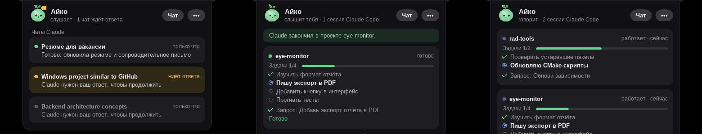

# Sprout 🌱

Росток — питомец голосового помощника Айко для Windows. Он живёт поверх окон, показывает состояние Айко и сообщает о задачах Codex.



Нативное приложение на C++ / WinAPI / GDI+. Работает одним exe без дополнительных рантаймов.

## Что умеет

- Слушая голос, удивляется и реагирует на громкость.
- Пока Айко думает, показывает вращающийся индикатор и пускает слюну.
- Во время ответа двигает ртом и показывает текст в облачке.
- Показывает уведомления Codex: завершение работы и ожидание ответа.
- Живёт поверх любых окон и перетаскивается мышью.
- Не превращается в островок по двойному клику.
- В меню можно включить или отключить микрофон Айко.
- При полном выходе из Ростка микрофон Айко автоматически ставится на паузу.
- Встроенный чат использует того же ИИ-собеседника и историю, что и Айко.

## Вместе с Айко

В конфигурации Айко укажи:

```json
{
  "face": "sprout",
  "sprout_exe": "%USERPROFILE%\\Desktop\\Sprout\\Sprout.exe",
  "sprout_link": true
}
```

Связь работает локально через `127.0.0.1`, файл `%APPDATA%\Sprout\aiko.json` и именованный канал Windows. Порт и токен создаются при каждом запуске.

Голосовые команды:

- «Айко, что делает Кодекс?»
- «Айко, какие задачи?»
- «Айко, разреши»
- «Айко, отклони»
- «Айко, перестань слушать»

## Установка

1. Положи `Sprout.exe` и `sprout-hook.exe` в одну папку.
2. В `config.json` Айко включи лицо `sprout`.
3. Запусти Айко: она запустит Росток автоматически.

Нужно: Windows 10 или Windows 11.

## Сборка

Visual Studio 2022 с компонентом разработки классических приложений на C++:

```bat
cmake -B build
cmake --build build --config Release
```

Или запусти `build.bat`.

Результат:

- `build\Release\Sprout.exe`
- `build\Release\sprout-hook.exe`

## Структура

```text
src/app/main.cpp           запуск приложения
src/app/island.cpp         интерфейс, питомец и облачко
src/app/pet.cpp            эмоции и анимации Ростка
src/app/aiko.cpp           локальная связь с Айко
src/app/chats.cpp          уведомления Codex
src/app/sessions.cpp       задачи и прогресс
src/app/pipe_server.cpp    локальный именованный канал
src/app/config.cpp         настройки и автозапуск
src/hook/hook_main.cpp     мост событий задач
```

## Лицензия

MIT — см. [LICENSE](LICENSE).
